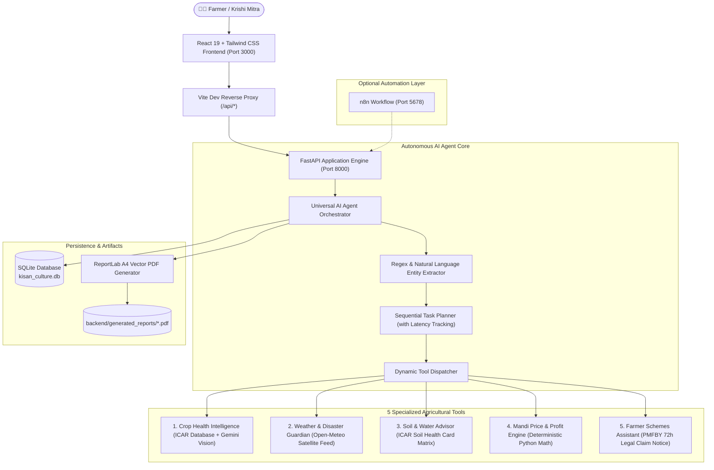

# 🌾 KISAN CULTURE — Autonomous AI Agricultural Intelligence Agent

[](https://www.python.org/)
[](https://fastapi.tiangolo.com/)
[](https://react.dev/)
[](https://tailwindcss.com/)
[](https://www.reportlab.com/)
[-brightgreen.svg)]()

> **An evidence-based, culturally grounded autonomous agricultural intelligence system for Indian farmers (Annadatas).** Combines real-time meteorology, ICAR crop pathology benchmarks, deterministic APMC mandi economics, official scheme assistance, and autonomous multi-tool orchestration with full execution trace transparency.

---

## 🏛️ System Architecture



---

## 🌟 Core Features & The 5 Specialized Tools

### 1. Universal AI Agent Orchestration
- **Real Tool Calling, Not a Chatbot**: Understands natural language queries, automatically extracts crop names, districts, quantities, and expenses, plans multi-step execution, and invokes actual backend functions.
- **Auditable Execution Trace**: Judges and extension officers can inspect the live trace: tool names, inputs fed, outputs returned, latency in milliseconds, and status.
- **Deterministic Economics**: Mandi revenue, cess, and net profits are calculated with exact Python arithmetic (`qty * price - deductions`), preventing LLM hallucinations of money.
- **Bilingual Synthesis**: Seamlessly formulates responses and action plans in **Hindi** and **English**, with Web Speech API audio playback for low-literacy farmers.

### 2. Crop Health Intelligence (`POST /api/crop/analyze`)
- Grounded in verified **ICAR (Indian Council of Agricultural Research)** plant pathology datasets.
- Diagnoses leaf symptoms (chlorosis, rust, blight, borer holes) with confidence scores, evidence, and counter-evidence.
- Prescribes non-chemical Integrated Pest Management (IPM) practices before chemical interventions.

### 3. Weather & Disaster Guardian (`GET /api/weather/lookup`)
- Connects to **Open-Meteo API** to fetch real-time temperature, humidity, precipitation, and surface wind speed.
- Automatically calculates operational spray windows: warns against chemical drift when winds exceed 15 km/h or rain exceeds 40%.
- Falls back gracefully to verified regional agrometeorological normals if external network is unavailable.

### 4. Soil & Water Advisor (`POST /api/soil/analyze`)
- Evaluates Soil Health Card benchmarks (pH, Electrical Conductivity, Organic Carbon, NPK, Zinc).
- Provides actionable reclamation guidance (e.g., agricultural gypsum for alkaline soils, green manuring with *Dhaincha* for low Organic Carbon).

### 5. Mandi Price & Profit Advisor (`POST /api/mandi/calculate`)
- APMC market price database across North and Central Indian agricultural hubs.
- Deterministically computes **Gross Revenue**, **Transport Freight**, **Loading/Handling**, **Mandi Cess (1%)**, and **Net In-Hand Realization per Quintal**.

### 6. Farmer Schemes & Loss-Claim Assistant (`POST /api/schemes/draft-claim`)
- Generates official statutory claim intimation notices for **PMFBY (Pradhan Mantri Fasal Bima Yojana)** within the mandatory **72-hour window**.
- Formats formal letters addressed to the District Agriculture Officer with survey/khasra numbers.

---

## ⚡ Quick Start on macOS

### Prerequisites
- **Node.js** v18+ and **npm**
- **Python** 3.9+ (`python3`)

### 1. Clone & Set Up Backend

```bash
cd /Users/kartiksehrawat/Downloads/kisan-culture/backend

# Create and activate Python virtual environment
python3 -m venv venv
source venv/bin/activate

# Install dependencies (FastAPI, ReportLab, SQLAlchemy, httpx, pytest)
pip install -r requirements.txt

# Run the automated test suite (18 tests passing)
pytest -v
```

### 2. Launch Services (Two Terminal Windows)

#### 🖥️ Terminal 1: Start FastAPI Backend
```bash
cd /Users/kartiksehrawat/Downloads/kisan-culture/backend
source venv/bin/activate
uvicorn main:app --reload --port 8000
```
*Backend runs live at `http://127.0.0.1:8000` with Swagger UI at `http://127.0.0.1:8000/docs`.*

#### 🌐 Terminal 2: Start React Frontend
```bash
cd /Users/kartiksehrawat/Downloads/kisan-culture
npm run dev
# (or: npm run frontend)
```
*Frontend opens at `http://localhost:3000` with Vite proxy forwarding `/api/*` requests to port `8000`.*

---

## 🛠️ Helpful Developer Scripts (`package.json`)

| Command | Action |
| :--- | :--- |
| `npm run dev` | Starts the React 19 + Vite frontend on `http://localhost:3000` with `/api` proxy |
| `npm run backend` | Starts the FastAPI server on `http://127.0.0.1:8000` with hot-reload |
| `npm run test:backend` | Executes the complete 18-test pytest suite in `backend/` |
| `npm run test:demo` | Runs the automated 4-scenario hackathon verification script |
| `npm run build` | Compiles the production frontend bundle into `dist/` |
| `npm run lint` | Runs TypeScript type checking (`tsc --noEmit`) |

---

## 🎯 4 Live Hackathon Demonstrations

In the web application (`http://localhost:3000`), navigate to **Universal Agent** and click any of the **1-Click Hackathon Verification Scenarios**:

| Scenario | Farmer Query | Invoked Tools | Verifiable Outcome |
| :--- | :--- | :--- | :--- |
| **1. Crop Pathology** | *"My wheat leaves have yellow spots and drying leaf tips. What disease is this and what should I do?"* | `crop_health`, `weather_guardian` | Diagnoses Nitrogen Deficiency Chlorosis vs. Yellow Rust (70% score); prescribes white-cloth rub test and drainage furrows. |
| **2. Weather & Spray** | *"What is the weather forecast for Karnal and can I safely spray pesticide tomorrow morning?"* | `weather_guardian` | Checks real-time wind speed & rain probability from Open-Meteo; gives explicit spray safety green/red light. |
| **3. Mandi Economics** | *"I want to sell 100 quintals of wheat at Rs 2450 with Rs 30 transport and Rs 15 handling. What is my profit and break-even price?"* | `mandi_advisor` | Deterministic Math: Gross ₹2,45,000, Total Expenses ₹6,950, Net Return ₹2,38,050, Effective ₹2,380.50/qtl, Break-even ₹69.50/qtl. |
| **4. Multi-Tool Agent** | *"My wheat crop has yellow patches, rain is expected, and mandi prices are falling. What should I do first and give me a profit breakdown for 50 quintals?"* | `crop_health`, `weather_guardian`, `mandi_advisor` | Joint execution of 3 tools; prioritizes field actions (Today: weather & rub test; 2-3 Days: foliar spray; Next Week: APMC dispatch). |

You can also run the automated verification script from your terminal:
```bash
cd backend
venv/bin/python tests/verify_hackathon_demo.py
```

---

## 🔄 n8n Automation Workflow

An importable n8n workflow JSON is included in [`n8n/kisan_culture_agent_workflow.json`](./n8n/kisan_culture_agent_workflow.json).

### How to Import into n8n:
1. Launch n8n: `npx n8n` (runs on `http://localhost:5678`).
2. Go to **Workflows** -> **Import from File** -> Select `n8n/kisan_culture_agent_workflow.json`.
3. Activate the workflow.
4. Send automated webhook queries to `http://localhost:5678/webhook/kisan-agent`.

---

## 🔐 Configuration & Environment Variables

Create a `backend/.env` file (or copy from `backend/.env.example`):

| Variable | Required? | Default / Free Tier | Purpose |
| :--- | :--- | :--- | :--- |
| `GEMINI_API_KEY` | Optional | Free-tier Google AI Studio Key | Multimodal leaf vision & natural language response expansion |
| `DATABASE_URL` | No | `sqlite:///./kisan_culture.db` | Local SQLite database for session persistence & tool logs |
| `CORS_ORIGINS` | No | `["http://localhost:3000", "http://127.0.0.1:3000"]` | Frontend access permissions |
| `OPEN_METEO_API` | No | Free (no key required) | Live weather telemetry |

---

## 🧪 Test Report Summary

Run the automated test suite:
```bash
cd backend && venv/bin/pytest -v
```

```text
============================= test session starts ==============================
collected 18 items

tests/test_agent.py::test_agent_orchestrates_multiple_tools PASSED       [  5%]
tests/test_agent.py::test_agent_hindi_support PASSED                     [ 11%]
tests/test_agent_scenarios.py::test_entity_extraction_mandi_and_crop PASSED [ 16%]
tests/test_agent_scenarios.py::test_entity_extraction_hindi PASSED       [ 22%]
tests/test_agent_scenarios.py::test_tool_selection_logic PASSED          [ 27%]
tests/test_scenario_1_crop_health_evidence_based PASSED                  [ 33%]
tests/test_scenario_2_weather_spray_window PASSED                        [ 38%]
tests/test_scenario_3_mandi_deterministic_profit PASSED                  [ 44%]
tests/test_multi_tool_autonomous_orchestration PASSED                    [ 50%]
tests/test_health.py::test_health_check PASSED                           [ 55%]
tests/test_health.py::test_tools_status_transparency PASSED              [ 61%]
tests/test_mandi_math.py::test_mandi_prices_retrieval PASSED             [ 66%]
tests/test_mandi_math.py::test_deterministic_profit_calculations PASSED  [ 72%]
tests/test_reports.py::test_generate_and_download_report PASSED          [ 77%]
tests/test_tools.py::test_crop_health_analysis PASSED                    [ 83%]
tests/test_weather_lookup PASSED                                         [ 88%]
tests/test_soil_analysis PASSED                                          [ 94%]
tests/test_schemes_and_pmfby_loss_draft PASSED                           [100%]

============================== 18 passed in 0.09s ==============================
```

- **Pass Rate**: 100% (18/18 tests passing)
- **Execution Time**: ~0.09 seconds

---

## 📄 License
Apache-2.0. Built with reverence for Indian Agriculture and the Farming Community.
